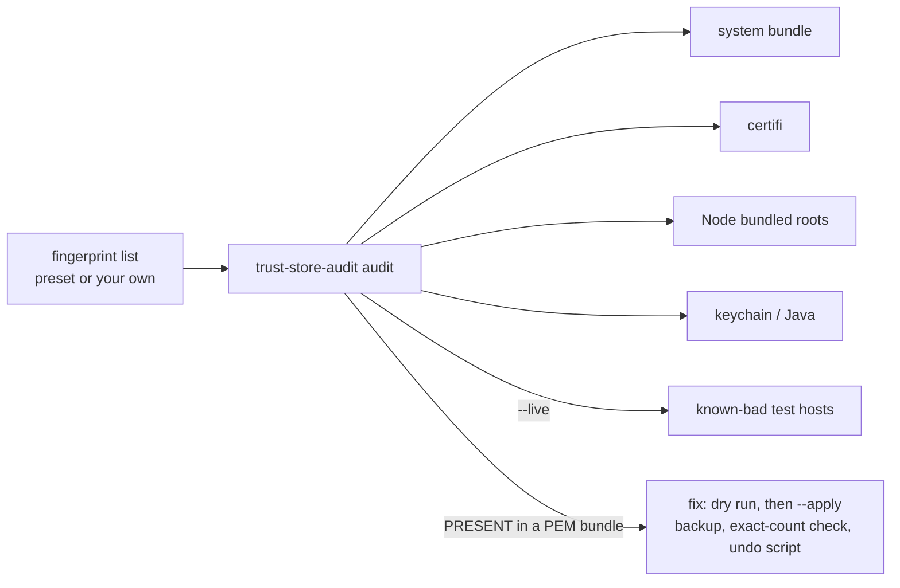

> **This project's home is now [github.com/globe-teck/trust-store-audit](https://github.com/globe-teck/trust-store-audit).** This copy stays up for existing links. Please open issues and pull requests there.

# trust-store-audit

[](https://github.com/leighsrodney-prog/trust-store-audit/actions/workflows/ci.yml)

Find, and optionally remove, distrusted root CAs across the common trust stores on a
Linux or macOS machine (system bundle, macOS keychain, certifi, Node.js, Java), by SHA-256 fingerprint.

When a certificate authority is distrusted, browsers usually update on their
own. Everything else on the machine does not: the OS bundle, Python's
`certifi`, the roots compiled into Node.js and Java's `cacerts` each keep their
own copy. This tool checks them all against a list of fingerprints, tells you
where the roots are still trusted, and can safely patch PEM bundles.

| Store                         | Where                                         | Audit | Fix                       |
| ----------------------------- | --------------------------------------------- | ----- | ------------------------- |
| Debian/Ubuntu system bundle   | `/etc/ssl/certs/ca-certificates.crt`          | yes   | yes (PEM)                 |
| macOS OpenSSL bundle          | `/etc/ssl/cert.pem`                           | yes   | yes (PEM)                 |
| macOS System Roots keychain   | `SystemRootCertificates.keychain`             | yes   | no (Apple updates it)     |
| Python `certifi`              | `certifi.where()` for each `--python`         | yes   | yes (PEM)                 |
| Node.js bundled roots         | `node -p tls.rootCertificates`                | yes   | no, use `--use-openssl-ca` |
| Java `cacerts`                | `$JAVA_HOME`, `java` on PATH, Debian path     | yes   | no (`keytool -delete`)    |



## Why

- **Browsers are not the whole machine.** After the October 2026 eMudhra distrust (Mozilla bug 2083449), browsers updated on their own, while Node's bundled
  roots and the macOS `/etc/ssl/cert.pem` still contained the affected roots on the machines I checked.
- **Fingerprints, not names.** Matching is by SHA-256 of the DER certificate,
  so a re-labelled copy of the same certificate is still caught and a look-alike name is never
  removed by mistake. A cross-signed or re-issued certificate has a different fingerprint; add it to the list separately.
- **Safe by default.** Every command is read-only unless you pass `--apply`.
  `sudo` is only ever used with `--apply`, and only when the target is not
  writable by you.
- **No dependencies.** Python 3 standard library and bash (CI-tested on Python 3.12).

## Quick start

```bash
git clone https://github.com/leighsrodney-prog/trust-store-audit trust-store-audit && cd trust-store-audit
./trust-store-audit audit             # eMudhra 2026 preset, read-only
./trust-store-audit audit --live      # also try TLS to the published test hosts
./trust-store-audit audit --json      # machine-readable
```

Exit codes: `0` clean, `1` a distrusted root is present (or a test host was
accepted), `2` usage or file error, `3` fix aborted.

Example output (Debian box with a patched system store, Node 20):

```text
trust-store-audit 0.1.0: checking 2 fingerprint(s)

STORE                              STATUS   CERTS  VERSION
debian-system-bundle               absent     148  ca-certificates 20250419+deb13u1
certifi (python3)                  absent     120  certifi 2026.10.19
node-bundled-roots                 PRESENT    149  node v20.19.2
                                     ! 86A1ECBA...36BBE6B  emSign ECC Root CA - G3
                                     ! D7A7A0FB...A699EF4  AAA Certificate Services
java-cacerts                       skipped      -
                                     (no Java cacerts found)
```

## Full sweep (0.2, `full-sweep` branch)

The default preset is now `presets/emudhra-2026.json`: all 16 compromised
intermediates (including the AAA cross-signs) and the 4 roots they chain to,
matched by certificate SHA-256 **and** by public-key (SPKI) SHA-256, so a
re-issued certificate that reuses a compromised key is caught too. It is
generated, never hand-edited, from the incident site's published data:

```bash
python3 tools/build_preset.py presets/sources presets/emudhra-2026.json   # re-derives and checks every hash
```

```bash
python3 -I trust_store_audit.py audit --apps \
  --projects ~/code \                         # bundles, keystores, venvs + lockfiles, Dockerfiles
  --scan /opt/homebrew --scan /Applications \ # bundles, keystores, pip/certifi installs
  --site example.com --ct example.com         # served chain + crt.sh
```

| Option        | What it checks |
| ------------- | -------------- |
| `--scan DIR`  | every CA bundle (`cacert.pem`, `roots.pem`, large `.pem/.crt`), Java keystore, and `pip`/`certifi` version (from `*.dist-info`) under DIR. Nothing found is executed. |
| `--projects DIR` | `--scan`, plus lockfiles (npm, pnpm, yarn, bun, uv, poetry, Pipfile, requirements, Cargo, go.mod) against the patched-versions table, and Dockerfiles to rebuild |
| `--apps`      | Electron apps in `/Applications` (version from the framework's `Info.plist`), `node`/`uv`/`go`/`rustup`/`bun`/`deno` versions, Node installs from nvm/fnm/volta/asdf/Homebrew, and roots embedded in binaries |
| `--site HOST` | the chain HOST actually serves |
| `--ct DOMAIN` | unexpired certificates for DOMAIN and subdomains issued under eMudhra (crt.sh) |

Binary scanning looks for each certificate's SPKI bytes (raw DER, JKS/PKCS12,
webpki-roots) and sample PEM lines (roots compiled into Node and Electron).
Patched Electron still embeds the roots (the fix is a blocklist), so Electron
verdicts come from the version. `presets/emudhra-2026-patched.json` mirrors the
site's patched-versions table. Clean sweep results are hidden unless `-v`.

## Your own list

The preset is `presets/emudhra-2026.txt`. Any file in the same format works:

```text
# SHA-256 fingerprint (hex, colons optional), then an optional label
86A1ECBA089C4A8D3BBE2734C612BA341D813E043CF9E8A862CD5C57A36BBE6B  emSign ECC Root CA - G3
```

```bash
./trust-store-audit audit -f my-distrust.txt --hosts my-test-hosts.txt --live
./trust-store-audit audit -f my-distrust.txt --bundle ./vendor/cacert.pem --only-bundles
./trust-store-audit audit --python python3 --python ~/venvs/app/bin/python
```

## Fixing a PEM bundle

```bash
./trust-store-audit fix /etc/ssl/cert.pem --expect 2            # dry run: shows what would go
./trust-store-audit fix /etc/ssl/cert.pem --expect 2 --apply    # back up, install, verify
```

With `--apply` the tool:

1. copies the bundle to `~/.trust-store-audit/<name>.bak-<timestamp>` and checks the copy;
2. removes each matching certificate block (plus its label lines) by fingerprint;
3. aborts, changing nothing, unless `before - removed == after`, the number
   removed equals `--expect` (when given), and no listed fingerprint remains;
4. writes `undo-<name>-<timestamp>.sh`, then installs the filtered file with
   the original mode (using `sudo install` only if needed) and re-checks it.

Store notes:

- **Debian/Ubuntu:** `update-ca-certificates` rebuilds the bundle. To make a
  removal stick, also deselect the root in `/etc/ca-certificates.conf` (prefix
  the line with `!`) and run `sudo update-ca-certificates`.
- **macOS:** OS updates may restore `/etc/ssl/cert.pem`; re-run after updates.
- **certifi:** `pip install -U certifi` once a fixed release is out; patching
  the file is a stopgap.

## Node.js

Node compiles the Mozilla roots into its binary, so patching the system store
does nothing for it. Until your Node release drops the root, tell Node to use
the system store:

```bash
. contrib/node-use-openssl-ca.sh     # appends --use-openssl-ca to NODE_OPTIONS once
./trust-store-audit node-guidance
```

`--use-openssl-ca` reads the default CA file of the OpenSSL Node was built
with. For Homebrew's Node that is Homebrew's `ca-certificates` bundle
(`$(brew --prefix)/etc/openssl@3/cert.pem`), **not** `/etc/ssl/cert.pem`, so
upgrade Homebrew's `ca-certificates` too (or set `SSL_CERT_FILE` to a patched
bundle) and confirm with `--live`.

**Official nodejs.org builds on macOS** (including Node copies bundled by tools
such as Codex or cursor-agent) have no OpenSSL store at their compiled-in path:
`--use-openssl-ca` alone makes every HTTPS request fail. Always pair it with
`SSL_CERT_FILE` pointing at a patched bundle, e.g.
`export SSL_CERT_FILE=/etc/ssl/cert.pem`.

`tls.rootCertificates` always lists the bundled roots, so the audit keeps
reporting Node as `PRESENT` even with the flag set. Use `--live` to compare
`node bundled` with `node --use-openssl-ca`.

## Live tests

`--live` connects to each host in `--hosts` (default: the 12 public eMudhra test
hosts) with Python's default context, with each PEM bundle found, and with Node
with and without `--use-openssl-ca`. A patched client should report `rejected`
for every host. Any `ACCEPTED` makes the exit code `1`. Treat this as a
cross-check: a rejection can also come from how the test host serves its chain,
so the fingerprint audit is the primary signal.

## Tests

```bash
python3 -m unittest discover -s tests -v
```

The tests use self-signed fixture certificates in `tests/fixtures/` (regenerate
with `tests/make_fixtures.sh`) and temporary folders; they need no network and
never touch a real trust store. CI runs them on Ubuntu and macOS, plus
`shellcheck`.

## Authorship

Built with AI coding assistance. I defined the requirements, ran the tests, and
reviewed the changes.

## License

MIT. See [LICENSE](LICENSE).
